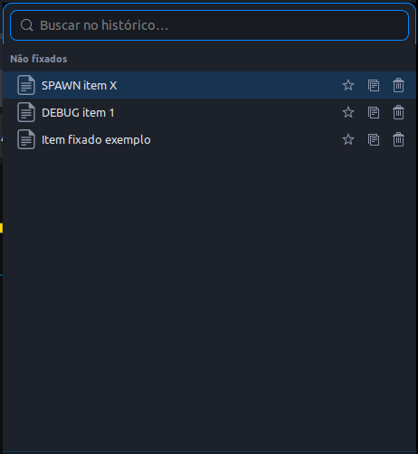

# ClipDev

Gerenciador de área de transferência (clipboard) para GNOME/Ubuntu, com ícone
na barra superior (perto do Wi-Fi) e abertura por atalho **Super+V**.



## Recursos

- Ícone no painel superior direito (AppIndicator).
- Atalho global **Super+V** para abrir/fechar o histórico.
- Histórico persistente de **até 50 itens não-fixados** (os mais antigos saem
  primeiro). Itens **fixados nunca são apagados**.
- Suporta **texto e imagens** (imagens salvas em disco + thumbnail, e podem ser
  copiadas de volta).
- Dedup automático: copiar algo que já existe promove o item ao topo.
- **Seções** "Fixados" e "Não fixados" na lista.
- Cada item tem **estrela para fixar** (cinza → amarela quando fixada).
- Barra vertical colorida à esquerda de cada item (amarela nos fixados).
- **Busca/filtro** no popup; **15 linhas visíveis** (rolagem para as demais).
- **Tamanho da fonte ajustável** (botões `−`/`+` no rodapé e na janela de
  Preferências) — a altura da linha acompanha.
- Botão **Limpar não fixados** no rodapé.
- Tema escuro: fundo `#1D212A`, azul `#0086FF`, fixados em amarelo `#FFC700`.

## Requisitos

- Ubuntu 22.04 / GNOME 42 (testado), sessão X11.
- `/usr/bin/python3.10` com `python3-gi` e `gir1.2-gtk-3.0` (já vêm no Ubuntu).
- `gir1.2-ayatanaappindicator3-0.1` — **necessário** para o ícone na barra:

  ```bash
  sudo apt install gir1.2-ayatanaappindicator3-0.1
  ```

> Observação: o projeto usa o `python3.10` do **sistema** porque é ele que tem o
> PyGObject. Se o seu `python3` do PATH for outro (ex.: 3.11 via pyenv), não
> afeta — o launcher fixa `/usr/bin/python3.10`.

## Instalação

```bash
./scripts/install.sh
```

Isso cria o comando `~/.local/bin/clipdev`, registra o atalho `Super+V` e
habilita o autostart no login. Depois:

```bash
clipdev run &     # inicia agora (ou apenas aperte Super+V)
```

### Se o Super+V não funcionar de imediato

O GNOME (`gsd-media-keys`) às vezes não recarrega atalhos recém-criados, e um
clipboard manager antigo (ex.: **Diodon**) pode estar segurando `<Super>v`. Nesse
caso:

```bash
# ver se outro app ocupa o Super+V
gsettings list-recursively | grep "'<Super>v'"

# recarregar o serviço de atalhos (ou simplesmente faça logout/login)
killall gsd-media-keys    # o GNOME sobe de novo automaticamente
```

## Uso

| Comando                     | O que faz                                   |
|-----------------------------|---------------------------------------------|
| `clipdev run`               | inicia o daemon (ícone na barra)            |
| `clipdev toggle`            | abre/fecha o popup (alvo do Super+V)        |
| `clipdev status`            | mostra daemon/atalho/autostart/ícone        |
| `clipdev clear`             | apaga os itens não-fixados                  |
| `clipdev install-shortcut`  | registra o Super+V                          |
| `clipdev uninstall-shortcut`| remove o Super+V                            |
| `clipdev autostart-install` | inicia no login                             |
| `clipdev autostart-remove`  | não inicia no login                         |

No popup:

- **Digitar** filtra; **↑/↓** navega; **Enter** copia; **Delete** exclui; **Esc** fecha.
- **Clique** copia o item (depois use Ctrl+V).
- No **hover** aparecem os botões: **estrela** (fixar/desafixar), copiar e excluir.
- Rodapé: **−/+** ajustam a fonte, **⚙** abre Preferências e **Limpar não fixados**
  apaga o histórico não fixado.

### Sobre o clique no ícone

No GNOME 42, a extensão que desenha os ícones de app (`ubuntu-appindicators`)
**sempre abre o menu** no clique esquerdo simples — é uma limitação da extensão,
não do ClipDev. Para abrir o histórico diretamente use o **Super+V** (ou o
duplo-clique no ícone). O menu do ícone traz atalhos para Preferências, Limpar e
Sair.

## Estrutura

```
clipdev/            # pacote principal
  app.py            # Gtk.Application: junta tudo
  clipboard.py      # monitor do clipboard (texto e imagem)
  store.py          # persistência SQLite (dedup, pin, retenção)
  images.py         # salva imagem + thumbnail
  popup.py          # janela do histórico (seções, estrela, fonte, rodapé)
  prefs.py          # janela de preferências
  indicator.py      # ícone na barra (AppIndicator)
  shortcut.py       # atalho global Super+V (GSettings)
  dbus_service.py   # controle por DBus (toggle/open/clear/quit)
  autostart.py      # inicialização no login
  style.css         # tema
  icons/clipdev.svg # ícone
scripts/            # clipdev (launcher), install.sh, uninstall.sh, test.sh
tests/              # testes unitários (pytest, headless)
docs/superpowers/specs/  # spec de design
```

## Desenvolvimento

```bash
./scripts/test.sh                    # roda os testes
python3.10 scripts/preview_popup.py  # gera um PNG de preview do popup
```

Os dados ficam em `~/.local/share/clipdev/` (banco, imagens e `settings.json`).
Para usar outro diretório (ex.: em testes): `export CLIPDEV_DATA_DIR=/tmp/algum`.

## Desinstalação

```bash
./scripts/uninstall.sh
# para apagar também o histórico e as imagens:
rm -rf ~/.local/share/clipdev
```